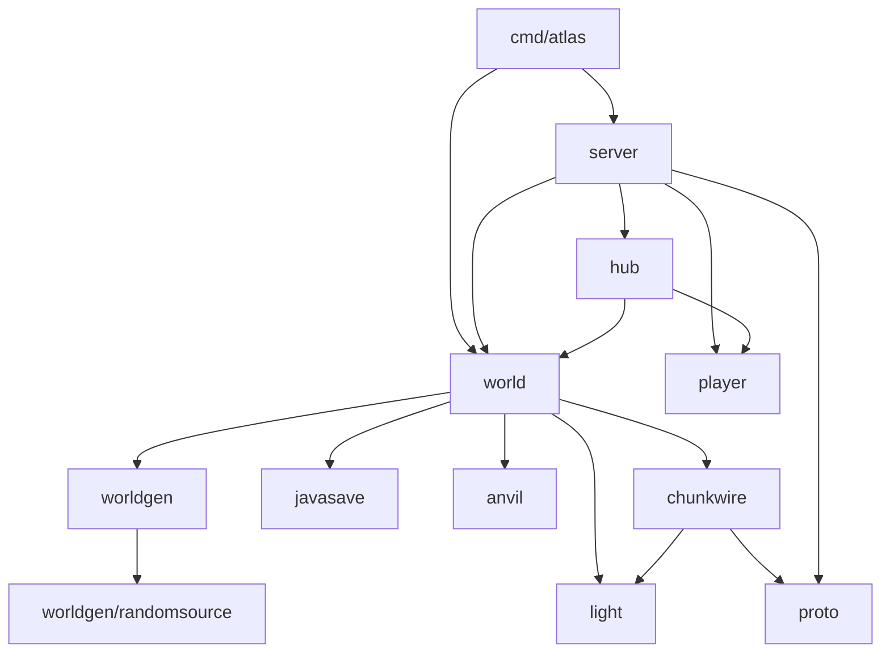

# Atlas 架构导航

Atlas 在一个 Go 进程中实现 Minecraft Java 1.21.1 的连接协议、部分游戏规则和世界生成。玩家连接、区域消息处理和区块生成通过协程并发运行。功能现状与兼容性限制见[项目 README](../README.md)，游戏术语见[术语表](../GLOSSARY.md)。

## 代码从哪里读起

| 问题 | 入口 |
| --- | --- |
| 启动、出生点预加载和定时保存 | [`cmd/atlas/main.go`](../cmd/atlas/main.go) |
| TCP 连接和生命周期 | [`server/server.go`](../internal/server/server.go)、[`login.go`](../internal/server/login.go)、[`play.go`](../internal/server/play.go) |
| 玩家状态与发送队列 | [`player/player.go`](../internal/player/player.go) |
| 可见玩家和广播接收者 | [`hub/hub.go`](../internal/hub/hub.go) |
| 区域所有权和区块任务 | [`world/world.go`](../internal/world/world.go)、[`region.go`](../internal/world/region.go) |
| 区块预约、交付与失败释放的契约 | [`world/chunk_delivery.go`](../internal/world/chunk_delivery.go)、[`player/dimension.go`](../internal/player/dimension.go) |
| Java 存档解释与世界衔接 | [`world/vanilla.go`](../internal/world/vanilla.go)、[`store.go`](../internal/world/store.go) |
| gzip/NBT 文件保存与恢复副本 | [`javasave/files.go`](../internal/javasave/files.go) |
| 区块和光照的网络编码 | [`chunkwire/encode.go`](../internal/chunkwire/encode.go) |
| 主世界生成和维度生成 | [`worldgen/overworld.go`](../internal/worldgen/overworld.go)、[生成文档](worldgen/README.md) |
| 不依赖世界状态的随机算法 | [`worldgen/randomsource`](../internal/worldgen/randomsource/) |

## 主要依赖

下图省略 `nbt`、配置和部分共享数据模块，重点展示运行时的职责关系。

`world.World` 表示单个维度的运行状态。`Server` 管理主世界、下界和末地的实例；它们使用同一个根存档的世界设置和玩家数据，各自读写对应的区块与实体区域。

生成算法不依赖 `server`、`player` 或世界运行实例。`randomsource` 只负责随机流与种子运算，可以独立验证。顶层 `worldgen` 保留原有随机类型和构造入口，维持现有调用者的兼容性。

## 状态由谁拥有

| 状态 | 管理方 | 访问方式 |
| --- | --- | --- |
| 已加载区块、待完成请求、区块数据包缓存 | 所属 Region | 通过消息进入区域协程 |
| 区域集合、世界元数据和生成任务生命周期 | World | 使用对应管理锁和生命周期操作 |
| 在线玩家索引 | Hub | 使用索引操作和快照；内部有读写锁 |
| 玩家位置、背包、已发送区块和可见实体 | Player 及 server 协调逻辑 | 使用状态操作；网络写入经独立发送队列 |
| 基础地形缓存 | worldgen | 缓存基础地形不可变，每次装饰使用私有修改层 |
| 区块编码输入 | 调用方 | chunkwire 同步借用数据，不保留输入或修改世界 |

每个 Region 管理 32×32 个区块，以单个协程依次处理消息。区块状态的串行所有权减少并发修改冲突；世界管理、玩家状态、区域文件和光照等共享部分仍然需要同步。

网络发送队列有界，慢客户端积压过多时会断开。区块生成由任务池完成，计算结果送回所属 Region 后再纳入运行状态。玩家移动或传送后，不再需要的视野任务可以取消。

## 三条常见调用流程

### 玩家登录

1. `server` 处理握手，区分状态查询与登录。
2. 开启正版模式时完成加密协商和 Mojang 会话验证，然后设置压缩并发送登录结果。
3. 配置阶段发送注册数据、特征标记等信息，等待客户端确认。
4. 恢复玩家数据，准备当前位置附近区块，再完成位置同步和游戏阶段初始化。
5. 通过 Hub 管理在线状态；实体可见性等待相关地形实际交付，避免玩家先看到悬空实体。

### 放置方块

1. `server` 解码玩家请求，检查物品、交互距离、目标状态和碰撞等规则。
2. `world` 将修改交给所属 Region，并协调必要的相邻方块和光照更新。
3. 区块修改保存成功后确认结果，失败时返回错误并进行客户端预测纠正。
4. 通过维度视图查找可见玩家，将更新交给各自的发送队列。

### 请求新区块

1. 根据玩家位置和视距计算请求；`RequestChunk` 和 `SpawnChunk` 负责预约，调用方无需预先预约或提供交付标记回调。
2. Region 复用已加载内容，并合并同一区块的重复等待请求。
3. 工作协程读取已有 Anvil 区块；缺失时运行对应维度的生成流水线。
4. 安装或更新光照、保存需要持久化的内容，将结果送回 Region。
5. 使用 chunkwire 编码网络内容，通过区块批次交付，并在状态变化时失效对应缓存。

`ChunkReceiver` 是请求与交付的显式 interface，要求预约去重、当前需求与距离查询、受保护交付和失败释放。生产 adapter 是绑定维度视图的 `WorldSink`；生成队列与 Region 不再猜测可选能力。距离与需求在同次玩家状态读取中确定，玩家移动后排队任务会重新比较距离；断线或旧维度视图不能保留普通视野任务。其他玩家仍需的任务、阻塞加载和已开始的生成继续按既有规则处理。

预约失败或重复请求是无操作；投递被世界拒收时同步返回错误并释放预约。生成失败、首区块加载失败或世界关闭也会释放未完成预约，旧视图的释放不能清除新视图的同坐标请求，也不能忘记已交付地形。批次发送与卸载、维度重置仍共享串行锁；“已交付”表示完整批次已进入服务器发送队列，不表示客户端确认。交付通知继续驱动地形之后的实体可见性更新。

方块与光照广播使用现有 `PacketSink`；广播接收者无需具备区块预约能力。区块状态仍归 Region，预约、已发送集合和维度视图仍归 Player，生成队列只负责挑选任务。

## 存档与编码如何分工

`world` 解释世界元数据、方块状态、实体和生成结果。`anvil` 管理 `.mca` 区域文件；`javasave` 管理压缩 NBT 文件的写入、替换和 `_old` 恢复副本；`chunkwire` 管理客户端需要的区块格式。方块实体的可见字段筛选目前仍在 `world`，随后把编码结果交给 chunkwire 组装。

调用方负责串行化同一路径的保存操作，文件读写模块不会替代世界级同步。网络格式与保存格式分别处理，不能把网络包直接作为完整存档。

## 修改后的验证

- 修改纯协议或规则时，先运行对应 `basic` 测试。
- 修改世界生成或随机流时，运行对应 `reference` 测试，并检查后续随机状态；真实世界生成场景在 `integration` 组。
- 修改跨模块调用、存档或区块编码时，增加 `smoke` 或 `performance` 中的真实进程场景。
- 修改参考数据生成工具时，检查环境、探针和数据输出的一致性。

命令及前置条件见[测试入口](../tools/README.md)。日常检查使用 `basic`，较慢的世界生成与加载场景使用 `integration`，可通过 `-Match` 和 `-Timeout` 指定范围与时间限制。完整参考组还需要仓库未全部提供的向量与互操作输入，运行前会先检查可静态识别的依赖。
